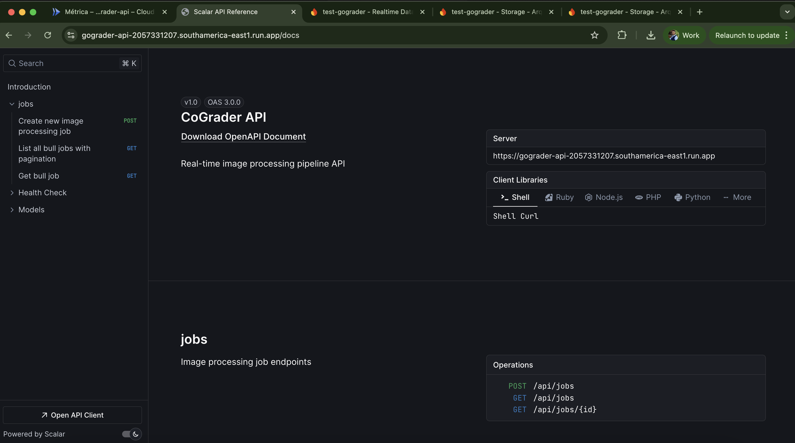
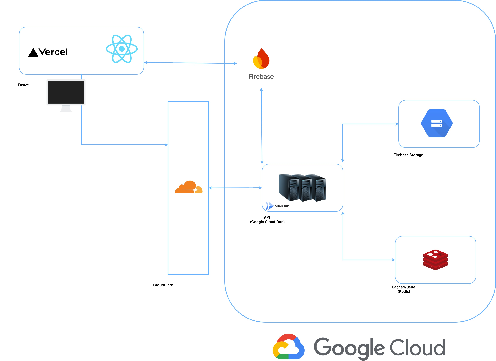

# CoGrader API - Image Processing Pipeline

Backend API for real-time image processing using NestJS, BullMQ, and Firebase.



> **Production API:** https://gograder-api-2057331207.southamerica-east1.run.app/api

## 🎯 Features

- Asynchronous image processing with BullMQ
- Real-time job status updates via Firebase
- Image transformations (resize, grayscale, watermark)
- Comprehensive error handling
- 20 TDD test cases (100% passing)

## 🏗️ Architecture



The system consists of:

- **Frontend**: React on Vercel with CloudFlare CDN
- **Backend**: NestJS API on Google Cloud Run
- **Database**: Firebase Realtime Database (real-time updates)
- **Storage**: Firebase Storage (processed images)
- **Queue**: Redis/BullMQ (job processing)

### Tech Stack

- **Framework**: NestJS (TypeScript)
- **Queue**: BullMQ + Redis
- **Database**: Firebase Realtime Database
- **Storage**: Firebase Storage
- **Image Processing**: Sharp

## 📊 Processing Flow

```
┌─────────────┐
│   Client    │
│  POST /jobs │
└──────┬──────┘
       │
       ▼
┌─────────────────────────────────────────────────────────────┐
│                     Jobs Controller                          │
│  1. Validate imageUrl                                        │
│  2. Create job in Firebase DB (status: pending)              │
│  3. Add job to BullMQ queue                                  │
│  4. Return job ID to client                                  │
└──────┬──────────────────────────────────────────────────────┘
       │
       ▼
┌─────────────────────────────────────────────────────────────┐
│                     BullMQ Queue                             │
│  • Redis-based queue system                                  │
│  • Automatic retries on failure                              │
│  • Concurrent job processing                                 │
└──────┬──────────────────────────────────────────────────────┘
       │
       ▼
┌─────────────────────────────────────────────────────────────┐
│              Image Processing Worker                         │
│                                                              │
│  Step 1: Download Image (Progress: 10% → 30%)               │
│  ├─ Fetch image from URL                                     │
│  ├─ Timeout: 10s, Max size: 10MB                            │
│  └─ Update status: active                                    │
│                                                              │
│  Step 2: Validate Image (Progress: 30% → 40%)               │
│  ├─ Check format (JPEG, PNG, WEBP)                          │
│  ├─ Verify file integrity                                    │
│  └─ Validate dimensions                                      │
│                                                              │
│  Step 3: Transform Image (Progress: 40% → 70%)              │
│  ├─ Resize to 800x600 (maintain aspect ratio)               │
│  ├─ Convert to grayscale                                     │
│  └─ Add watermark "Processed by CoGrader"                    │
│                                                              │
│  Step 4: Upload to Storage (Progress: 70% → 90%)            │
│  ├─ Upload to Firebase Storage                               │
│  └─ Get public URL                                           │
│                                                              │
│  Step 5: Complete Job (Progress: 90% → 100%)                │
│  ├─ Update status: completed                                 │
│  └─ Save resultUrl                                           │
└──────┬──────────────────────────────────────────────────────┘
       │
       ▼
┌─────────────────────────────────────────────────────────────┐
│                  Firebase Realtime DB                        │
│  • Real-time updates to client                               │
│  • No polling required                                       │
│  • WebSocket-based listeners                                 │
└─────────────────────────────────────────────────────────────┘
       │
       ▼
┌─────────────┐
│   Client    │
│  (Receives  │
│   updates)  │
└─────────────┘
```

### Error Handling Flow

```
Any Step Fails
     ↓
Update status: "failed"
     ↓
Save error message
     ↓
Notify client via Firebase
     ↓
Job marked as failed
(can be retried by BullMQ)
```

## 🚀 Quick Start

### Prerequisites

- Node.js 18+
- Redis running
- Firebase project setup

### Installation

```bash
pnpm install
```

### Environment Setup

Create `.env`:

```env
REDIS_HOST=localhost
REDIS_PORT=6379
REDIS_PASSWORD=

GOOGLE_FIREBASE_ADMIN_SDK={"type":"service_account","project_id":"..."}

PORT=8080
NODE_ENV=development
```

### Run

```bash
# Development
pnpm run start:dev

# Production
pnpm run build && pnpm run start:prod
```

API available at: `http://localhost:8080`

## 📡 API Endpoints

### Create Job

```bash
POST /api/jobs
Content-Type: application/json

{
  "imageUrl": "https://example.com/image.jpg"
}
```

**Response:**

```json
{
  "id": "550e8400-e29b-41d4-a716-446655440000",
  "imageUrl": "https://example.com/image.jpg",
  "status": "pending",
  "progress": 0,
  "createdAt": "2025-10-29T17:30:00.000Z",
  "updatedAt": "2025-10-29T17:30:00.000Z"
}
```

### Get Job Status

```bash
GET /api/jobs/:id
```

### List All Jobs

```bash
GET /api/jobs
```

### Health Check

```bash
GET /api/queue/health
```

## 🧪 Testing

### TDD Implementation

**20 test cases** covering all scenarios:

```bash
# Run tests
npm test -- processing.service.spec.ts

# Expected: ✅ Test Suites: 1 passed, Tests: 20 passed
```

**Test Categories:**

✅ **Positive Scenarios (7)**

- Process JPEG, PNG, WEBP images
- Track progress updates (10% → 30% → 40% → 70% → 90% → 100%)
- Apply transformations correctly

✅ **Negative Scenarios (9)**

- Download failures
- Invalid formats (TIFF)
- Oversized images (>10MB)
- Invalid buffers
- Upload failures

✅ **Edge Cases (4)**

- Minimum size (1x1 pixel)
- Exactly 10MB limit
- No image enlargement
- Continue on status update failure

### Manual Testing

```bash
# Valid image
curl -X POST http://localhost:8080/api/jobs \
  -H "Content-Type: application/json" \
  -d '{"imageUrl": "https://picsum.photos/1200/800"}'

# Invalid format
curl -X POST http://localhost:8080/api/jobs \
  -H "Content-Type: application/json" \
  -d '{"imageUrl": "https://www.google.com"}'

# Multiple jobs
for i in {1..5}; do
  curl -X POST http://localhost:8080/api/jobs \
    -H "Content-Type: application/json" \
    -d '{"imageUrl": "https://picsum.photos/800/600"}' &
done
wait
```

## 🔍 Error Messages

All errors use i18n-ready SNAKE_CASE constants:

```typescript
IMAGE_NOT_FOUND_404; // 404 error
IMAGE_TOO_LARGE; // >10MB
IMAGE_INVALID_FORMAT; // Not PNG/JPG/WEBP
IMAGE_DOWNLOAD_FAILED; // Network error
IMAGE_DOWNLOAD_TIMEOUT; // >10s timeout
IMAGE_TRANSFORMATION_FAILED; // Sharp error
IMAGE_UPLOAD_FAILED; // Storage error
```

Frontend can translate these keys to any language.

## 📁 Project Structure

```
src/
├── modules/
│   ├── jobs/                    # Job management
│   │   ├── dto/
│   │   ├── jobs.controller.ts
│   │   └── jobs.service.ts
│   ├── images/                  # Image processing
│   │   ├── processing/
│   │   │   ├── processing.service.ts
│   │   │   └── processing.service.spec.ts  # 20 tests
│   │   └── validator/
│   │       └── validator.service.ts
│   └── queue/                   # BullMQ management
│       └── queue.service.ts
└── shared/
    ├── google/firebase/         # Firebase integration
    │   ├── database/
    │   └── storage/
    └── constants/
        └── messages.enum.ts     # i18n messages
```

## 🚢 Deployment

```bash
# Build
docker build -t cograder-api .

# Deploy to Cloud Run
gcloud run deploy cograder-api \
  --image cograder-api \
  --platform managed \
  --region us-central1
```

## 📝 Key Design Decisions

1. **BullMQ**: Reliable Redis-based queue with retries
2. **Firebase**: Real-time WebSocket updates (no polling)
3. **Sharp**: Fast native image processing
4. **Modular Architecture**: Easy to test and maintain
5. **i18n Messages**: All errors translatable via SNAKE_CASE keys

## 🌐 Production

**API URL:** https://gograder-api-2057331207.southamerica-east1.run.app/

**API Documentation:** https://gograder-api-2057331207.southamerica-east1.run.app/api

## 👨‍💻 Author

**Velrino Neto**

- GitHub: [@velrino](https://github.com/velrino)
- LinkedIn: [/in/velrino](https://www.linkedin.com/in/velrino/)

_Developed with assistance from Claude AI for TDD implementation and code architecture_

## 📄 License

UNLICENSED - Challenge project

---


